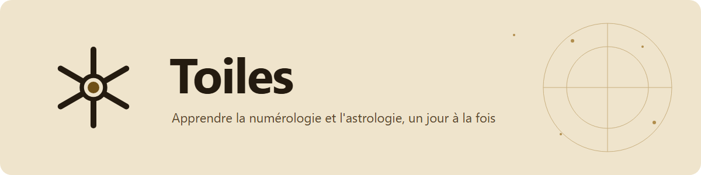
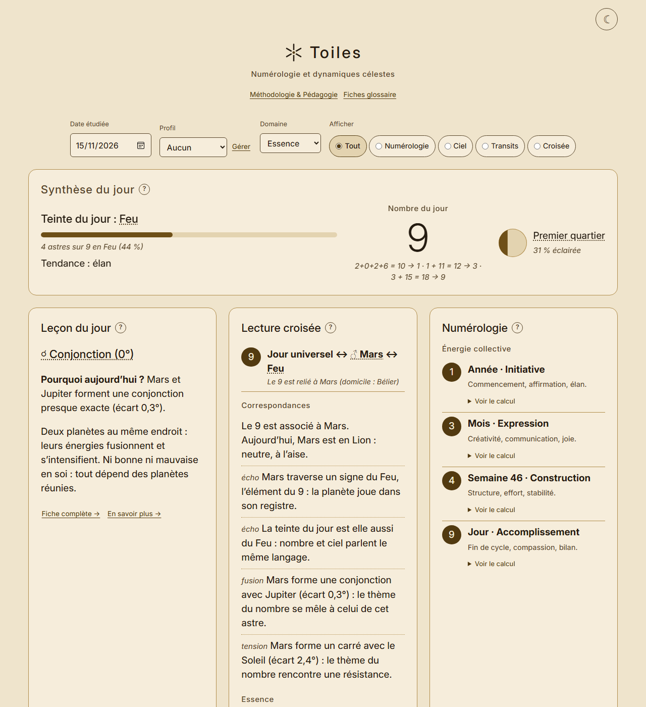
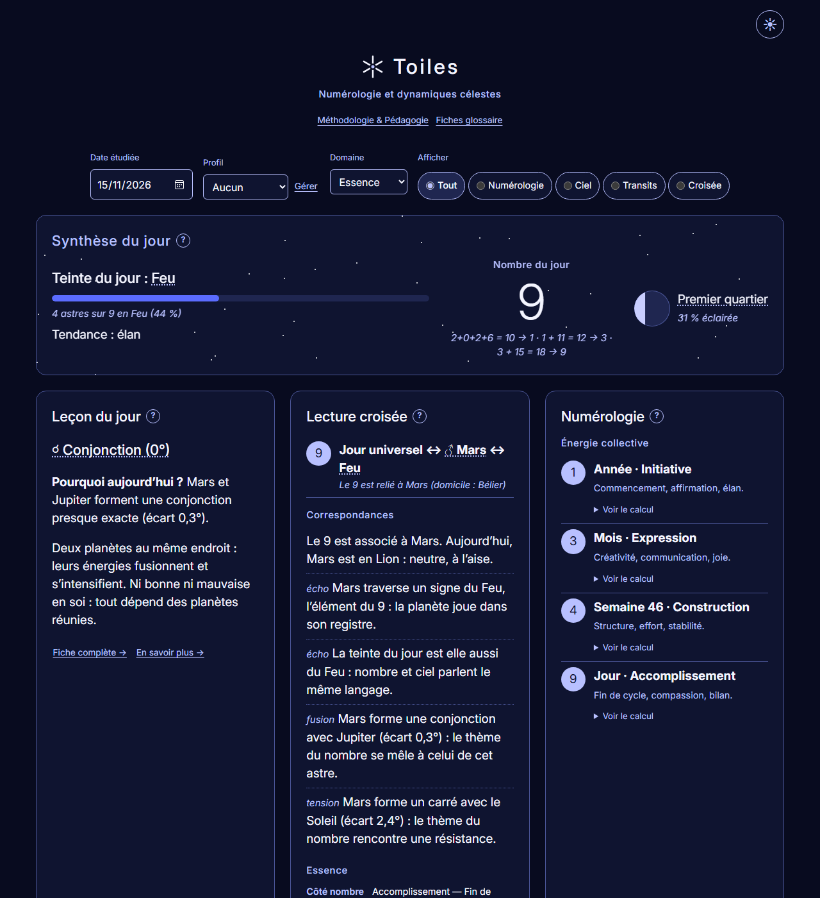
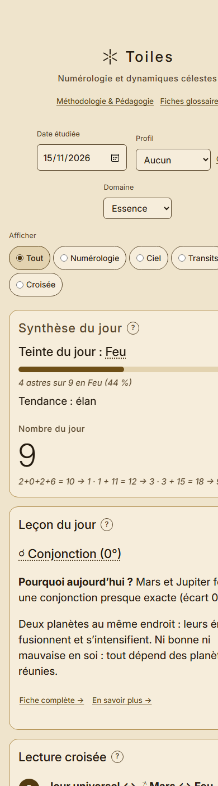

<!-- Bannière : la version claire ou sombre s'affiche selon le thème de GitHub.
     Sources modifiables : images/banniere-*.svg (les .png en sont des rendus). -->
<picture>
  <source media="(prefers-color-scheme: dark)" srcset="images/banniere-sombre.png">
  
</picture>

<h1 align="center">
   Toiles
</h1>

<p align="center">
  Outil personnel pour <b>apprendre</b> la numérologie et l'astrologie en les pratiquant au quotidien.<br>
  JS / HTML / CSS <b>vanilla, sans dépendance</b>. S'ouvre par double-clic sur <code>index.html</code>.
</p>

<p align="center">
  
  
  
  
</p>

---

## Aperçu

<table>
  <tr>
    <td width="40%"></td>
    <td width="40%"></td>
    <td width="20%"></td>
  </tr>
  <tr align="center">
    <td><i>Carte céleste</i> (clair)</td>
    <td><i>Nuit vivante</i> (sombre)</td>
    <td>Téléphone</td>
  </tr>
</table>

Synthèse du jour, leçon du jour, lecture croisée et nombres — chaque résultat montre son calcul.

---

## Cahier des charges

### Principes
- **Usage** : personnel, orienté apprentissage. Chaque résultat montre *comment* il est obtenu et *ce qu'il signifie*.
- **Traditions** : numérologie pythagoricienne, astrologie tropicale géocentrique.
- **Granularité** : lecture **par jour** (pas d'heure précise).
- **Textes** : concis, mots-clés + phrases courtes. Rédigés pour Toiles, sans source externe imposée.
- **Domaines** : essence, amour, travail, finances, santé, spiritualité.
- **Interface** : sobre et claire, s'adapte à l'ordinateur et au téléphone.
- **Accès** : fichier local (double-clic sur `index.html`), ou en ligne via GitHub Pages (voir *Publication en ligne*).
- **Code** : commenté en détail, en français, pour être compris et modifié à la main.

### Modules
Utilisables seuls ou ensemble. Chacun a une **infobulle « Comment ça marche »** : principe, base de calcul, limites.

| Module | Rôle | Données nécessaires |
|---|---|---|
| **Numérologie** | Nombres universels et personnels : jour, semaine, mois, année | Date (+ naissance pour le personnel) |
| **Ciel** | Planètes Soleil → Neptune, Lune, rétrogradations, aspects, éléments et modes | Date |
| **Transits** | Le ciel du jour comparé au thème natal d'un profil | Date de naissance (+ heure et lieu pour les maisons) |
| **Lecture croisée** | Correspondances **expliquées** entre nombres, ciel et transits (ex. « le 4 et la Lune en Taureau parlent tous deux de stabilité ») | Ce qui est disponible |
| **Cycles longs** | Cycle de 9 ans, cycles de vie, pinacles et défis | Date de naissance |
| **Nombres du nom** | Expression, élan spirituel, moi intime | Nom complet de naissance |
| **Points complémentaires** | Pluton, Chiron, nœuds lunaires (affichés à part, sans voter) ; comparaison tropical / sidéral (Lahiri, Fagan-Bradley) | Date |
| **Suivi** | Calendrier du mois (nombres + lunaisons), journal de bord, quiz | Date (+ profil) |

### Apprentissage
- **Calcul détaillé** à déplier sous chaque résultat (ex. 2026 → 2+0+2+6 = 10 → 1).
- **Fiches glossaire** : une par nombre, signe, planète, aspect.
- **Leçon du jour** : un concept expliqué à partir des nombres ou du ciel du jour.
- **Quiz** : questions à choix multiples fabriquées à partir des fiches.
- **Journal de bord** : noter son ressenti du jour, avec une « photo » des nombres et du ciel ; export .json et .md.

### Profils
- Plusieurs profils (moi + proches), enregistrés dans le navigateur.
- Par profil : nom, date de naissance, et en option l'heure et le lieu.
- Lieu : petite liste de villes intégrée + saisie manuelle latitude/longitude en secours.
- Nom complet de naissance (facultatif) pour les nombres du nom.
- Export et **import** du fichier de sauvegarde (.json) : les doublons (même nom, même date) sont ignorés.

---

## Avancement

Tâches ouvertes, plan de route et idées pour plus tard : voir [`TODO.md`](TODO.md).
Consignes de travail pour Claude : voir [`CLAUDE.md`](CLAUDE.md).

---

## État actuel (brouillon)

Un premier jet existe déjà et servira de base à la vue Aujourd'hui :

```
index.html            page de démonstration
src/numerologie.js    module numérologie  → Toiles.numerologie
src/astres.js         module ciel          → Toiles.astres
src/complements.js    Pluton, Chiron, nœuds lunaires, zodiaque sidéral → Toiles.complements
src/calendrier.js     calendrier mensuel (nombres + lunaisons) → Toiles.calendrier
src/journal.js        journal de bord (données seulement) → Toiles.journal
src/quiz.js           quiz fabriqué depuis le glossaire → Toiles.quiz
src/transits.js       transits personnels (ciel du jour × thème natal) → Toiles.transits
src/textes.js         textes des infobulles « Comment ça marche » → Toiles.textes
src/glossaire.js      définitions des termes (nombres, planètes, signes, aspects, ℞…) → Toiles.glossaire
src/positions.js      « planète en signe » : 108 textes + dignités → Toiles.positions
src/fiches.js         fiches complètes assemblées depuis le glossaire → Toiles.fiches
src/profils.js        profils (données seulement), stockés dans le navigateur → Toiles.profils
src/methodologie.js   volet méthodologie et pédagogie → Toiles.methodologie
tests/index.html      tests permanents, en double-clic (ou : node tests/tout.js)
src/app.js            vue Aujourd'hui : filtre, infobulles, rendu, panneaux
src/toiles.css        styles
```

Les modules s'attachent à `globalThis.Toiles` : ils fonctionnent dans le navigateur (`<script>`) comme dans Node (`require('./src/astres.js')`).

**Calculs** : éléments orbitaux de Paul Schlyter + perturbations principales (Lune, Jupiter, Saturne). Précision < 1°, vérifiée sur l'équinoxe de mars 2024 et la pleine lune du 23/04/2024.

## Publication en ligne (GitHub Pages)

Toiles est un site **statique** : aucun serveur, aucune compilation. Le dépôt peut donc être publié tel quel.

1. Sur GitHub, ouvrir le dépôt → **Settings** → **Pages**.
2. *Source* : **Deploy from a branch** ; *Branch* : `main`, dossier `/ (root)` → **Save**.
3. Après une minute, la page est en ligne à l'adresse `https://<compte>.github.io/toiles/`.

Ce qui rend cela possible sans adaptation :
- tous les chemins sont **relatifs** (`src/…`, `polices/…`, `images/…`) : ils marchent en `file://` comme sous `/toiles/` ;
- le fichier vide **`.nojekyll`** à la racine demande à GitHub de servir les fichiers tels quels (sans passer par Jekyll) ;
- la police Inter est embarquée (`polices/`), aucun CDN n'est appelé.

À savoir :
- **Les données restent dans le navigateur de chaque visiteur.** Les profils et le journal enregistrés en double-clic (`file://`) ne sont **pas** visibles sur la version en ligne (et inversement) : le navigateur les range par adresse. Pour passer de l'un à l'autre : *Exporter les profils* puis *Importer des profils*.
- Une page GitHub Pages est **publique** : n'y mets pas de données personnelles dans le code (les profils, eux, ne quittent jamais le navigateur).
- `tests/index.html` est aussi publié : pratique pour vérifier la version en ligne.

**Installer Toiles comme une application (PWA)** : en ligne seulement. Sur ordinateur (Chrome, Edge), cliquer sur l'icône d'installation dans la barre d'adresse. Sur Android, ouvrir le menu ⋮ puis *Installer l'application*. Sur iPhone (Safari), toucher *Partager* puis *Sur l'écran d'accueil*. L'application s'ouvre alors dans sa propre fenêtre et fonctionne hors ligne. Les fichiers en jeu sont `manifest.webmanifest`, `sw.js` et `images/icones/`. Si tu ajoutes un fichier à l'application, ajoute-le aussi à la liste `FICHIERS` de `sw.js` et augmente `VERSION`.

**Convention à connaître** : la « semaine » numérologique n'a pas de règle standard. Toiles utilise *mois + n° de semaine ISO*.
